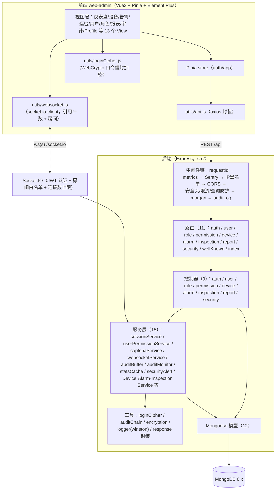
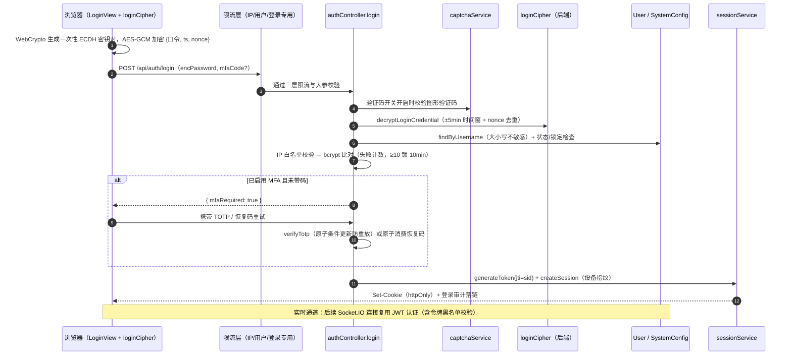
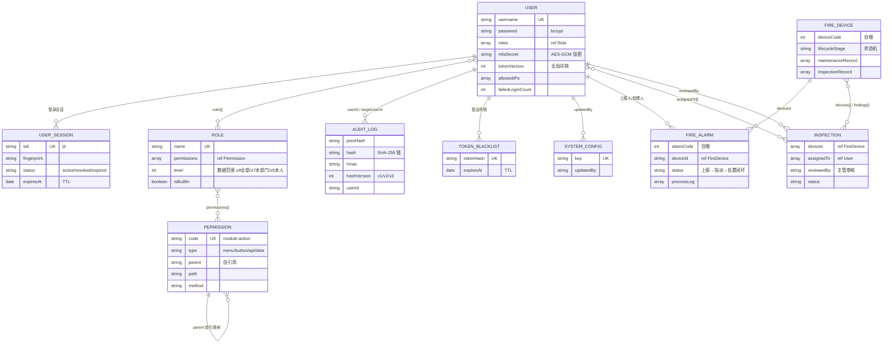
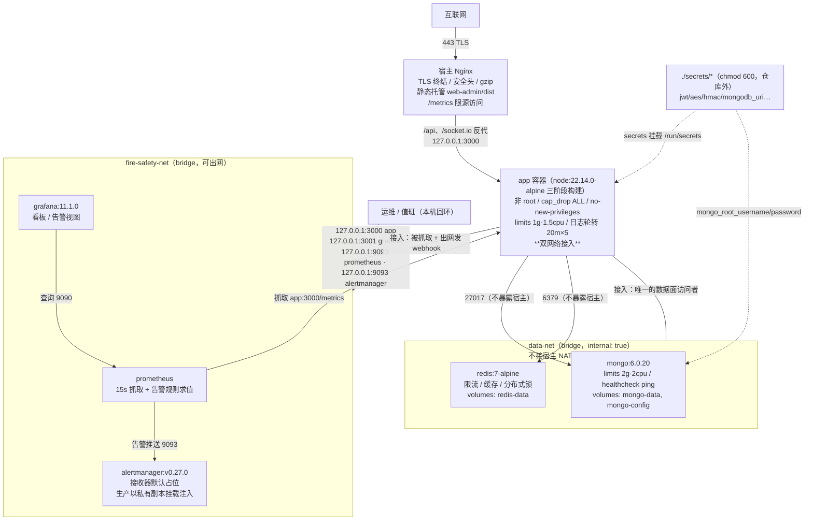

# 系统架构文档

> 优化清单 H-3 建档（2026-08-29）。图均为 Mermaid 源码，GitHub / VS Code / Typora 可直接渲染。
> 安全决策背景另见 [ADR 目录](./adr/README.md)。

## 1. 总体架构

前后端分离：Vue 3 管理后台 + Express REST API + MongoDB，Socket.IO 承载实时推送。

**分层约定**：请求一律经 路由 → 控制器 → （服务层）→ 模型。已知技术债：部分控制器直连模型（优化清单 D-1），新功能要求强制经服务层。

## 2. 登录时序

关键实现：`src/controllers/authController/credentials.js`（login 约 L140）、`src/utils/loginCipher.js`、`src/services/sessionService.js`；时序对齐防用户枚举（哑 bcrypt 耗时）。

## 3. 数据模型（ER 图）

模型清单：`User / Role / Permission / FireDevice / FireAlarm / Inspection / AuditLog / UserSession / TokenBlacklist / IPBlacklist / SystemConfig`（`src/models/`）。

## 4. 部署拓扑

当前 `docker-compose.yml` 定义的目标生产形态（TLS 终结的 Nginx 在宿主侧，示例配置见 `deployment/nginx.conf.example`）。

**本图以 `docker-compose.yml` 为唯一生成源**（F-06，2026-10-17 重画）。此前的图把 MongoDB 画在
`fire-safety-net` 里、与 app 同网，而实际 compose 中 mongo **只**在 `data-net`（且该网络
`internal: true`）——按旧图排障会连错网络、也会误判"app 能否直连数据面"这个安全边界。
图与 compose 的一致性由 `src/tests/deploy/architectureDocContract.test.js` 钉住：
compose 里增删服务/网络而文档没跟上，那条门禁会红。

**网络边界（三句话，排障时先看这段再看图）**：

1. `fire-safety-net` 是**边缘/监控面**：app、prometheus、alertmanager、grafana 在此网。
   app 的出网能力（`securityAlertDelivery` 的 webhook）与 Prometheus 的抓取都走这张网。
2. `data-net` 是**数据面**且 `internal: true`：mongo、redis 只在此网，**没有宿主端口、不能出外网**。
   监控栈与宿主发布面都摸不到数据面——这条分段直接封掉的反向路径是
   "Grafana 数据源 URL 可配任意地址 ⇒ 可达无密码 redis（删黑名单键 = 撤销封禁、
   清限流计数 = 解除封顶）"，见文末 networks 段的注释与 ADR-005。
3. **app 同时接入两张网**（这是唯一同时接入的服务）：既要被 prometheus 抓取、要出网发告警
   webhook，又要访问 mongo/redis。把数据面单独拆成 internal 网络，才能让"监控面容器直连数据库"
   这件事在**网络层**不成立，而不是靠应用层鉴权兜。新增服务时不要顺手把它加进 `data-net`。

**宿主端口（全部绑 127.0.0.1，不对公网）**：

| 服务         | 宿主端口 | 说明                                    |
| ------------ | -------- | --------------------------------------- |
| app          | 3000     | 由宿主 Nginx 反代；直接访问仅限本机排障 |
| grafana      | 3001     | 容器内 3000，宿主 3000 已被 app 占用    |
| prometheus   | 9090     | 查询 / 状态页                           |
| alertmanager | 9093     | Web UI；Prometheus 经容器网络推送到此   |
| mongo        | 无       | 仅 `data-net`，容器内 27017             |
| redis        | 无       | 仅 `data-net`，容器内 6379              |

要点：

- **密钥注入**：全部经 Docker secrets 文件（`*_FILE`），`environment` 只留非敏感项（见 ADR-003）
- **镜像钉版本**：仓库内所有第三方镜像引用都已钉到 registry digest（`name:tag@sha256:<64hex>`，保留可读 tag）——Dockerfile 的 3 处 `node:22.14.0-alpine`、compose 的 mongo / redis / prometheus / alertmanager / grafana、`.github/workflows/ci.yml` 的 mongo service 容器。digest 的取值与核验口径见 `scripts/verify-image-digests.js`（对返回字节自算 sha256，且要求 ≥2 个运营主体不同的来源一致），对账闸是 `src/tests/security/imageReferenceInventory.test.js`（优化清单 R-5）
- **Redis** 已在 compose 中实际运行（非注释态）：`redis:7-alpine` 钉了 digest，app 以 depends_on 等其健康后启动；承接限流/缓存/分布式锁（R-3/A-1）
- **前端静态托管已落地**（L-1，P0）：由 `src/middleware/staticFrontend.js` 托管 `web-admin/dist`；通过 `SERVE_FRONTEND` 启用、`FRONTEND_DIST` 指定产物目录。内置 `/assets` 一年强缓存 immutable、`index.html` 与 `sw.js` no-cache、SPA history 回退、`.map`/`.ts` 显式拦截，并配套专项测试覆盖。

## 5. 前端结构速览

- 路由：`Layout` 包裹 11 个业务子路由（`meta.permission` 控权）+ 独立登录/注册页；`beforeEach` 做会话恢复与权限校验
- 实时推送场景：权限变更同步（`permission-sync` 定向投递）、告警实时推送、设备状态更新
- 全局兜底：`utils/errorReporter.js` 收敛组件/资源/未处理 Promise 三路错误（G-1）

## 6. 数据一致性与事务策略（第二轮审计 B-3）

第二轮审计（2026-09-03）核对全仓 51 处写点后的结论：仅设备删除（`DeviceService.deleteDevice`）存在真实的跨集合多步写，其余均为单集合原子写。据此确立以下一致性策略：

- **单集合写**：一律依赖 MongoDB 单文档原子性，不引入事务。
- **跨集合多步写**：必须经 `src/utils/transaction.js` 的 `withTransaction` 包裹——副本集/分片拓扑走 session 事务（任一步失败整体回滚）；standalone 拓扑按能力探测**确定性降级**为顺序执行并告警一次（不靠「先写失败再重试」误判能力），此时多集合一致性依赖应用层写入顺序。
- **生产部署**：按副本集部署（docker-compose 的 mongo 为单节点，扩容副本集后事务自动生效，无需改代码）。
- **新增多步写决策顺序**：能否退化为单集合原子写 → 不能则 `withTransaction` → 仍不能则补偿逻辑，禁止裸的多步顺序写。
- 现存多步写点位：设备删除（`deleteDevice`，告警引用 → 巡检引用×2 → 设备删除）。设备报废（`scrapDevice`）的 scrapDate 补录已合并进 `transitionTo` 单次原子写（B-2），不再是多步写。

> 注：本文出现的「优化清单 X-N」为建仓前遗留的历史编号（源文件 `deliverables/待优化项总清单-2026-08-29.md` 从未进入版本库且已不存在），无源可查。该编号体系已废弃，新提交一律使用 `P*/R*/T*`——详见 `CONTRIBUTING.md` §5。
